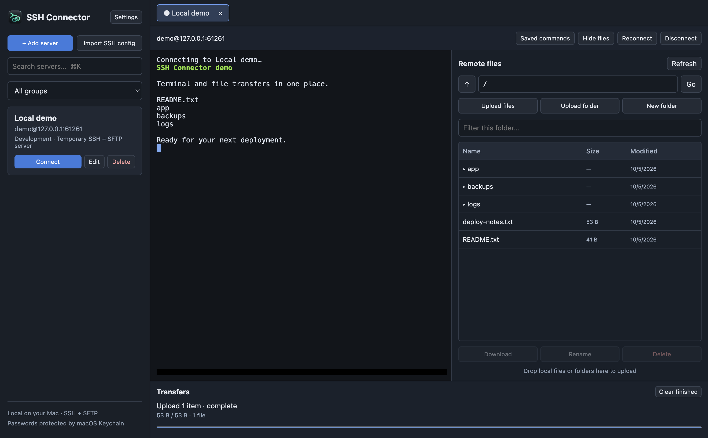
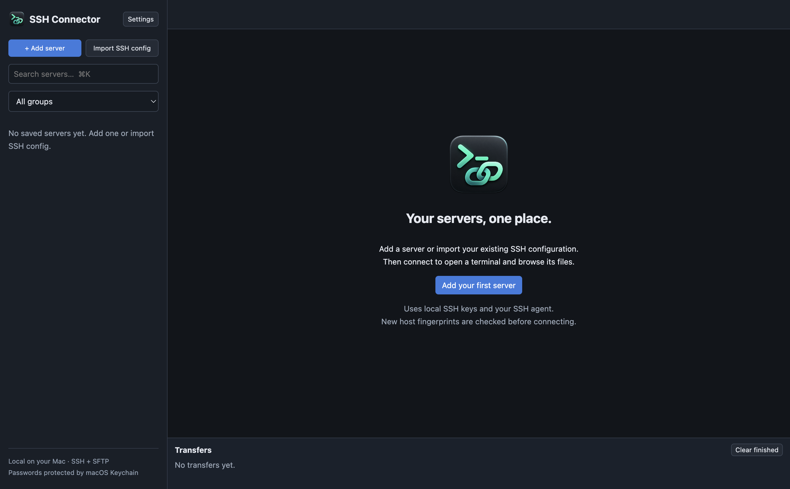
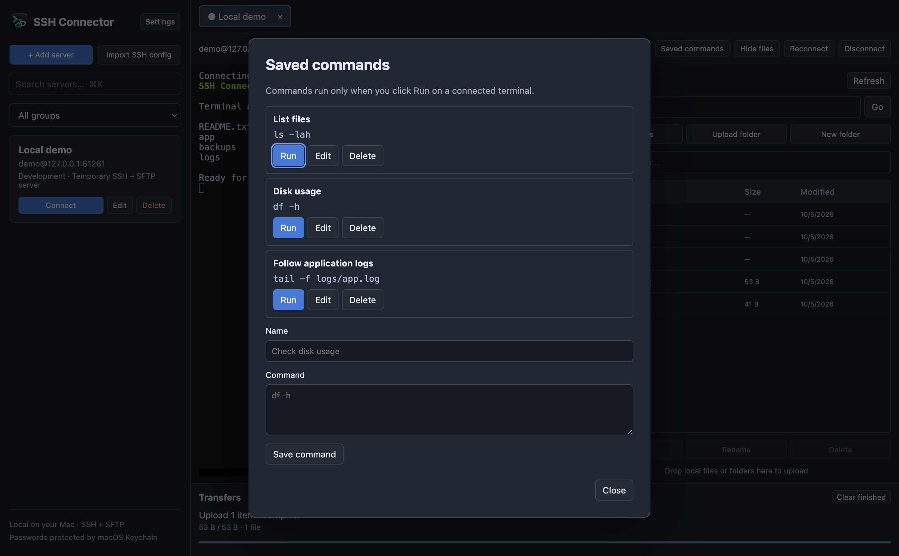

<p align="center">
  
</p>

# SSH Connector

**Your servers, one place.** A local macOS app for saved SSH connections, terminal tabs, and SFTP file transfers.

[](LICENSE)

[](https://www.electronjs.org/)

No account or cloud service required. Your connection settings stay on your Mac, and saved passwords are encrypted with macOS Keychain protection.



## Why I made this

I was keeping server details, usernames, and passwords in a document. As I added more servers, maintaining that document and finding the right credentials became harder. I wanted an easier way to manage my connections without typing the same SSH commands again and again.

File transfers were awkward too. I built SSH Connector to keep saved servers, a terminal, and a remote file browser together: pick a server, connect, and work with its files in the same window.

I'm open-sourcing it so others with the same workflow can use it, inspect the code, and improve it.

— [Aaron Jevil Nazareth](https://github.com/jevil25)

## Features

- **Saved servers:** names, groups, notes, search, and SSH config imports.
- **Terminal tabs:** multiple simultaneous connections and reconnect controls.
- **SFTP alongside the terminal:** browse, upload, download, rename, and delete remote files.
- **Folder transfers:** recursive uploads/downloads, drag and drop, progress, queues, and cancellation.
- **Flexible authentication:** saved passwords, private keys, encrypted keys, SSH agents, and interactive prompts.
- **Jump hosts:** connect through bastions, including multiple hops.
- **Saved commands:** keep frequent commands ready and run them explicitly.
- **Local backups:** export server settings and commands without passwords, keys, or trusted fingerprints.

## Screenshots

These are captures of the actual app using disposable demo data and a local SSH/SFTP test server. They contain no personal server details or real credentials.

### Start with your saved servers



### Keep frequent commands handy



To regenerate all three screenshots on macOS:

```sh
npm run screenshots
```

The capture script uses a temporary app database and removes the demo server and its files when it finishes.

## Getting started

### Requirements

- **macOS:** the app uses macOS Keychain and the system OpenSSH tools. Windows and Linux are not supported by the current implementation.
- **Node.js 22.12 or newer** and npm for running from source. Development checks were run with Node.js 22.
- An SSH-accessible server; enable its SFTP subsystem to use the file browser.

### Run from source

```sh
git clone https://github.com/jevil25/ssh-connector.git
cd ssh-connector
npm ci
npm start
```

### Build a Mac app

```sh
npm run pack  # Create a .app bundle
npm run dist  # Create a DMG
```

Open `release/mac-arm64/SSH Connector.app` on Apple Silicon, or `release/mac/SSH Connector.app` on Intel. The output depends on the build machine's architecture. These commands create local unsigned builds; signing and notarization are not configured.

## How it works

1. **Save or import a server.** The app stores connection metadata locally and encrypts saved passwords through Electron's `safeStorage` API.
2. **Resolve SSH settings.** The main process calls your Mac's `/usr/bin/ssh -G` to resolve aliases, users, ports, identities, and jump hosts.
3. **Authenticate and verify the host.** The `ssh2` library opens the connection, checks the host key, and authenticates with your password, keys, or SSH agent.
4. **Open the workspace.** An xterm.js terminal and an SFTP browser share the same SSH connection. Each tab has its own session.
5. **Transfer files.** Operations are queued per connection, report progress, and write temporary files before replacing destinations.

The renderer runs with context isolation, sandboxing, and Node integration disabled. A preload bridge exposes specific IPC operations; the main process owns SSH sessions, credential storage, and file access.

| File | Responsibility |
| --- | --- |
| `src/main.js` | Electron window, IPC handlers, dialogs, and transfer queues |
| `src/ssh.js` | SSH configuration, authentication, host verification, jump hosts, and SFTP |
| `src/store.js` | Saved servers, encrypted passwords, backups, and remembered host keys |
| `src/preload.js` | Restricted bridge between the UI and main process |
| `src/renderer.js` | Server list, terminal tabs, file browser, commands, and transfer UI |
| `test/` | Store tests and local SSH/SFTP integration fixtures |

## Use

1. Choose **Add server**, enter a name and IP/hostname, and save. Leave port and username blank to inherit SSH configuration defaults. You can also choose **Import SSH config** to import named hosts from `~/.ssh/config` and its includes.
2. Enter a password to save it, choose a local private key, or leave both blank to use configured keys and the Mac’s running SSH agent. Encrypted private keys prompt for a passphrase; passphrases are kept in memory for authentication only.
3. Choose **Connect**. Confirm a new server fingerprint after checking it with your provider. The terminal and remote file browser open together.
4. Double-click folders to navigate. Select a file/folder and use Download, Rename, or Delete. Upload files/folders with the buttons or drop them onto the file browser.
5. Use separate terminal tabs for simultaneous sessions, **Reconnect** after disconnecting, and **Saved commands** for explicitly running commands you use often.

Groups and search organize saved servers. `⌘K` focuses search, `⌘N` adds a server, and `⌘W` closes the active connection tab.

## Credentials and server identity

- Passwords are encrypted at rest using Electron safeStorage, whose encryption key is protected by macOS Keychain. The database contains encrypted values, not plaintext passwords. This is local storage protection, not a separate master-password lock.
- The app reads local SSH key files without copying or modifying them. An unlocked SSH agent can provide keys without exposing their private contents to the app.
- Existing host keys are checked against configured `known_hosts` files. New fingerprints are remembered in the app. Changed or revoked host keys block connections. **Settings → Clear saved host fingerprints** clears app trust after independent verification; it does not edit `known_hosts`.
- Metadata, encrypted passwords, saved commands, and app fingerprints are in `servers.json` under Electron’s macOS Application Support directory for this app. Files use permission `0600` and saves use an atomic rename.
- **Settings → Export backup** exports server settings and commands. Passwords, private keys, and fingerprints are excluded so the backup can move between Macs. Imports merge without replacing existing server credentials. Keep the original local database for recovery on the same Mac; password ciphertext is tied to its Keychain encryption key.

## Transfers

- Supports recursive uploads/downloads, empty folders, binary files, bulk selection, progress, a queue per connection, and cancellation.
- Remote deletion and both local and remote overwrites require confirmation. Rename refuses an existing destination.
- Transfers write to temporary files before replacing their destinations. OpenSSH supports atomic remote replacement; other SFTP servers use a rollback copy. Interrupted files are not reported as successful; already completed files in a folder transfer remain.
- Symlink transfers are rejected rather than following links outside the selected tree. Symlink directories can be browsed. Deleting a symlink removes the link itself.
- Servers must have the SFTP subsystem enabled. The terminal can still work when a server does not provide SFTP.

## SSH configuration and jump hosts

Connection settings are resolved by your Mac’s `/usr/bin/ssh -G`, including HostName, User, Port, IdentityFile, IdentityAgent, and ProxyJump. Terminal and SFTP sessions use the same SSH2 connection. Jump hosts accept SSH aliases or `user@host:port`, including comma-separated hop chains. Save jump hosts separately to reuse their saved passwords.

The app supports common RSA, ECDSA, and Ed25519 private keys, encrypted keys, SSH-agent authentication, password login, and keyboard-interactive prompts (including OTPs). VPN access uses your Mac’s active VPN. It does not manage VPN clients.

This is not a full OpenSSH replacement: custom ProxyCommand programs, SSH certificates/FIDO security-key algorithms, X11 forwarding, local/remote port-forward management, and every OpenSSH configuration directive are not implemented. Use ProxyJump for bastions. The app does not enable agent forwarding to remote hosts.

## Development and verification

```sh
npm run check     # JavaScript syntax checks
npm test          # Store and local SSH/SFTP tests
npm run test:app  # Electron integration test; requires macOS GUI and Keychain
```

The connection tests use temporary local SSH/SFTP servers to verify password/key authentication, terminal input/output, file operations, host-key rejection, reconnect, and jump hosts. The Electron integration test uses an isolated temporary database and checks Keychain encryption, real IPC and terminal rendering, recursive binary transfers, overwrite/delete confirmations, saved commands, and reconnect. It never connects to your saved servers.

## Contributing

Bug reports and pull requests are welcome. See [CONTRIBUTING.md](CONTRIBUTING.md) for setup, checks, and what to include in an issue or pull request.

## Built with

- [Electron](https://www.electronjs.org/) for the desktop app and [safeStorage](https://www.electronjs.org/docs/latest/api/safe-storage) for saved-password encryption.
- [ssh2](https://github.com/mscdex/ssh2) for SSH and SFTP connections.
- [xterm.js](https://github.com/xtermjs/xterm.js) for terminal rendering.
- [electron-builder](https://www.electron.build/) for macOS packaging.

## License

[MIT](LICENSE) © 2026 [Aaron Jevil Nazareth](https://github.com/jevil25).

You can use, modify, and redistribute this project under the MIT license. Third-party dependencies retain their own licenses.
